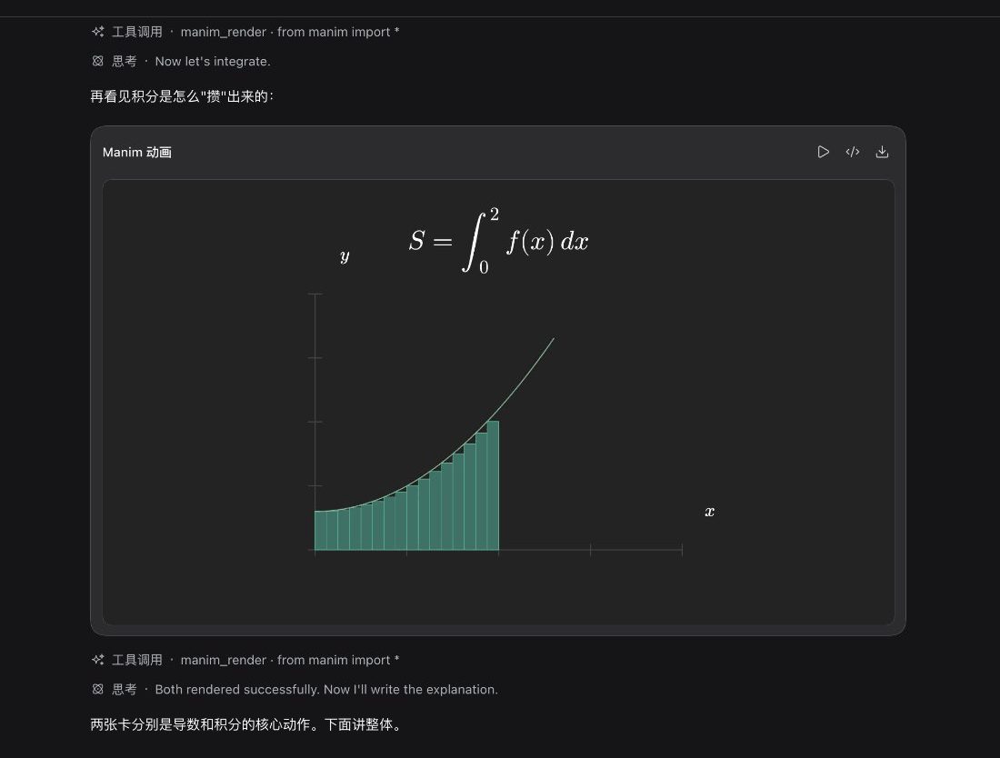

# dsh-manim-card

给 DeepSeek Harness 加一个能力：**AI 在聊天里直接写 Manim 代码，当场在聊天流里出现一张可播放的动画卡片**——能播放、能查看代码。

代码在浏览器内执行，运行资源随插件分发，**本机不需要安装 Python**，也不依赖任何外部服务。



> 线上文档（安装 / 在聊天里用 / 设置面板，中英双语）：<https://snowowowo.github.io/dsh-manim-card/>

## 特点

- **卡片就长在聊天流里**：一行标题、一块画布，右侧两个按钮——播放 / 查看代码。播放完停在终态画面，不会自己重来。
- **先预检，再呈现**：代码返回前先在真解释器里跑一遍，语法错与不支持的写法当场回给模型、同一回合修正，聊天里不会留下空白或残缺的卡片。
- **不要求本机 Python**：执行在浏览器内完成，运行资源随插件分发。
- **播放有分寸**：只有刚生成的那张卡真播一遍；重新挂载与旧会话里的卡一律直接落终态。手动播放一键压过全部自动规则。

## 安装

在宿主的插件管理里：

```
dsh plugin add github:snowowowo/dsh-manim-card
```

装完刷新宿主页面，设置里出现「Manim卡片」一节。首次渲染需要取一次运行资源（约 13 MB），之后离线可用。

## 用起来

在会话里说一句「用 Manim 画一个单位圆」，卡片随即出现在聊天流中。更多细节见文档站的[在聊天里用](https://snowowowo.github.io/dsh-manim-card/guide/usage)。

## 开发

技术栈、目录结构、开发流程与测试分工见文档站的[开发与调试](https://snowowowo.github.io/dsh-manim-card/dev/)。

```bash
pnpm install
pnpm build      # 产出 client.js
pnpm test       # 单测（不联网那一档）
pnpm docs       # 本地起文档站
```

## 许可

本项目依 **MIT** 授权，全文见 [LICENSE](./LICENSE)。

随包分发的运行资源与构建产物内联的第三方组件，各依其自身许可——清单见 [THIRD-PARTY.md](./THIRD-PARTY.md)。
